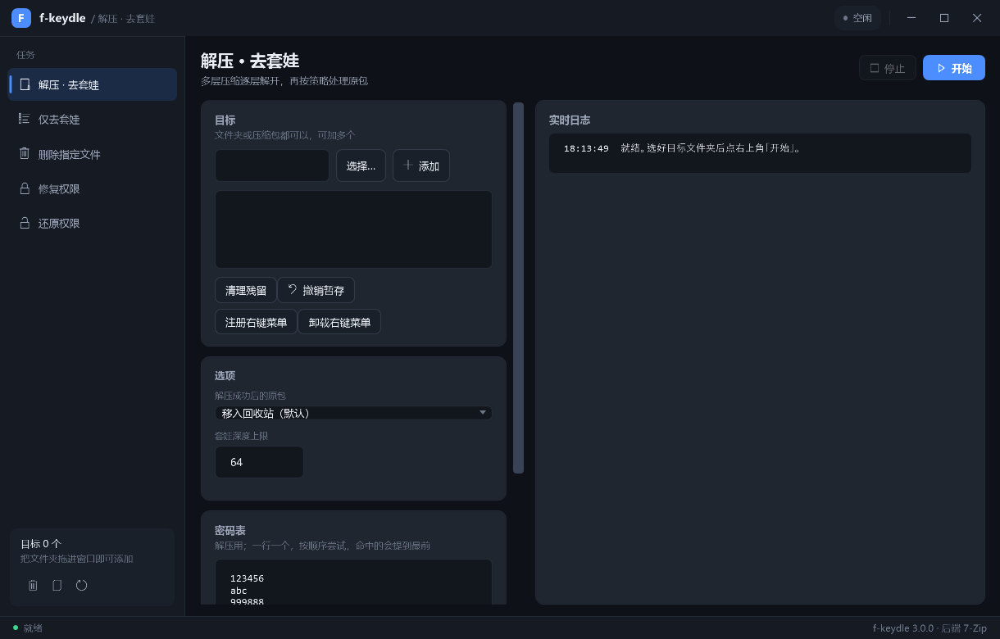

# layerpeel

一个 Windows 上「解压 · 去套娃 · 清残留」的小助手。绿色便携，双击即用，默认不写注册表（右键菜单可选，手动注册到 HKCU）。

**下载：** [Releases](../../releases) 里的 `layerpeel-<版本>-portable.zip`（约 1.1 MB，解压即用）。
**解压后体积：** 约 2.6 MB（主程序 199 KB + 随包 7-Zip）。
**依赖：** Windows + .NET Framework 4.x（Win10 1809 起与 Win11 系统自带）。

## 它解决什么问题

从网盘拖下来一堆压缩包，是这么个场面：

- 里面套外面，一层又一层，解完还有一层；
- 被「已解压」「新建文件夹 (2)」「套娃」这种壳目录裹了七八层，点进去全是空壳；
- 包里顺手夹了 `推广链接.url`、`福利.jpg`、`_MACOSX`、`请先点我.txt` 之类的东西；
- 解到一半留下的 `_layerpeel_tmp_*`、半成品文件散得到处都是；
- 从别人电脑拷来的目录权限被改坏，双击打不开、删不掉。

layerpeel 就是把这五件事一次做完，并且**每一步都留退路**。

## 功能

| 功能 | 说明 |
|---|---|
| 多层解压 | 自动识别嵌套压缩包并逐层解开，直到不再有压缩包 |
| 去文件夹套娃 | 只压平目录层级、移除空壳目录，**不解压** |
| 清理残留 | 按规则删除指定文件（默认：`*.url`、`*推广*`、`*福利*`、`_MACOSX`），可勾选「保护压缩包」 |
| 权限修复 / 还原 | 修复目录读写权限；修复前逐项备份 SDDL，可一键还原成完全一致的状态 |

界面是**原生 Windows 窗口**（WPF）：不打开浏览器、不监听任何端口、不联网、不上报任何东西。



文件夹可以直接拖进窗口里。

## 安全设计（都是踩过坑之后加的）

- **不靠界面文字判断成败**：只看 7-Zip 退出码 + `7z t` 完整性校验。7z 用错密码也会返回退出码 2，
  而且已经把半成品写到磁盘上了，所以「看起来成功了」完全不能信。
- **先落同盘临时目录，对账通过才并入目标目录**：解压过程中出任何问题都不会污染你的原目录。
- **删原包之前先确认包是好的**：校验不过只提示，不动原包。
- **默认删到回收站**，不是永久删除；超过回收站配额自动退到暂存目录 `_layerpeel_trash_`，可一键还原。
- **默认不提权**：不需要管理员，不弹 UAC。
- **所有外部进程用参数数组启动**，绝不把配置内容拼进命令行。
- **每个包处理完写一条审计日志**：`运行数据\日志\audit-*.jsonl`。

## 快速开始

1. 从 [Releases](../../releases) 下载 `layerpeel-<版本>-portable.zip`
2. 解压到任意目录（建议非系统盘）
3. 双击 `启动 layerpeel 3.0.bat`
4. 程序窗口直接打开。也可以把要处理的文件夹拖到那个 `.bat` 上，或者直接拖进窗口里

配置都在 `config.json` 里：密码表、删除规则、保护扩展名、套娃深度上限，改完直接生效。

## 目录

```
layerpeel\
├─ layerpeel.exe            主程序（单文件，界面已编译内嵌）
├─ 7z.exe / 7z.dll         随包便携 7-Zip（官方二进制，原样分发）
├─ config.json             配置（密码表、删除规则、行为上限）
├─ 启动 layerpeel 3.0.bat    启动器
├─ 说明.txt                包内速查
└─ 运行数据\               日志、权限备份（可随时删）
```

## 从源码构建

需要的环境：Windows、Node.js（只用来跑构建脚本）、.NET Framework 4.8（系统自带）、
以及 `C:\Program Files\7-Zip\7z.exe`（只有编译测试样本时才用得到）。

```bat
node 构建.js       :: 编译 → 发布\layerpeel.exe
node 自测.js       :: 24 条断言的端到端自测
node 打包发布.js   :: 打包 → 绿色版\layerpeel\
```

编译器直接用系统自带的 `csc.exe`（`%WINDIR%\Microsoft.NET\Framework64\v4.0.30319\`），
**不需要装 .NET SDK，也没有任何 NuGet 依赖**。

源码结构：

| 文件 | 职责 |
|---|---|
| `Core.cs` | JSON / 配置 / 审计日志 / 安全删除（回收站 + 暂存目录） |
| `SevenZip.cs` | 7-Zip 封装：魔数粗筛、探测、试密码、`7z t` 校验、解压、参数引号 |
| `Engine.cs` | 核心引擎：多层解压去套娃 / 仅去套娃 / 清理残留 + 对账 |
| `Junk.cs` | 删除指定文件（glob 规则、保护压缩包、拒绝通配一切） |
| `Acl.cs` | 权限备份 / 修复 / 还原（原生 .NET 读写 SDDL） |
| `Jobs.cs` | 任务执行层（界面与命令行共用） |
| `Theme.cs` | 深色主题（运行时 XAML，不需要 MSBuild） |
| `WpfUi.cs` | WPF 原生窗口界面（纯 C# 写，不用 XAML 编译） |
| `Menu.cs` | 资源管理器右键菜单（写 HKCU，不需要管理员） |
| `Program.cs` | 入口：命令行、界面模式、启动器协议 |

## 自测判据

`node 自测.js` 里 24 条断言都是真实结果，不是「应该能跑」：

- 三层套娃（外层 `.zip` → 内层 `.7z` → 最内层 `.zip`）全部解出，压缩包清空；
- `报告.docx` / `表格.xlsx` / `假程序.exe` / `普通文本.txt` 一个都不许动；
- `推广链接.url` 被删，而普通文件不误删；
- 临时残留目录被清掉；
- 权限修复 → 还原之后，SDDL 与修复前**逐字节相同**。

## 许可与来源

**本项目按 [GNU GPL v3.0](LICENSE)（或更新版本）发布，不提供任何担保。**

它是 **[ssh-buanshishi / f-keydle](https://github.com/ssh-buanshishi/f-keydle______Multilayer-Compression--and--single-chained---Folder-Nesting--handler)**（原项目同样按 GPL-3.0 发布）的 C# 重写版，**自 2026-10-12 起**：

- 用 C# 重新实现了原版的全部功能，界面与引擎都是新写的；
- 解压后端由 Bandizip + AutoHotkey 换成 7-Zip，去掉了对第三方商业软件与预编译产物的依赖；
- 为兼容原版的配置文件格式（提供迁移功能），代码中沿用了其配置标记行的字符串。

正因为原项目是 GPL-3.0，本重写版也**必须**以 GPL-3.0 发布 —— 这是 GPL 的要求，不是可选项。
原始项目的版权归原作者所有。

包内的 `7z.exe` / `7z.dll` 是 [7-Zip](https://www.7-zip.org/) 的官方二进制，未做任何修改，
版权归 Igor Pavlov，按 GNU LGPL 发布（其中 unRAR 部分受额外限制），详见
<https://www.7-zip.org/license.txt>。

---

想了解内部实现与踩坑记录，见 [`DEVELOPMENT.md`](DEVELOPMENT.md)。
